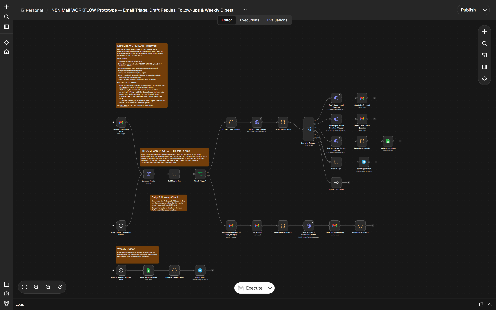
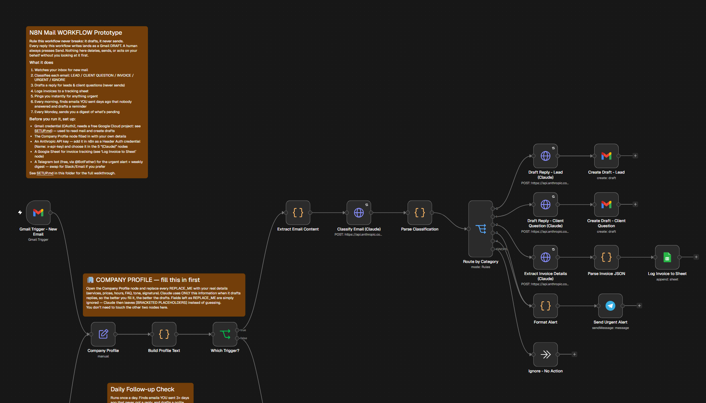
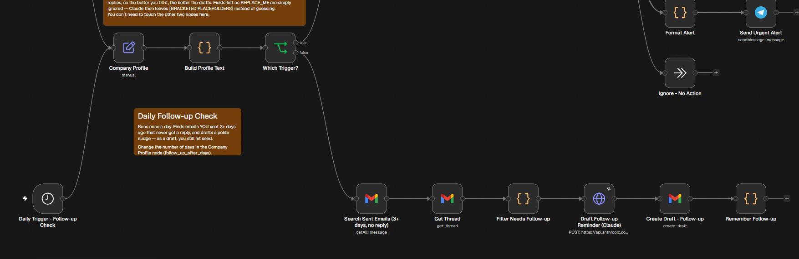
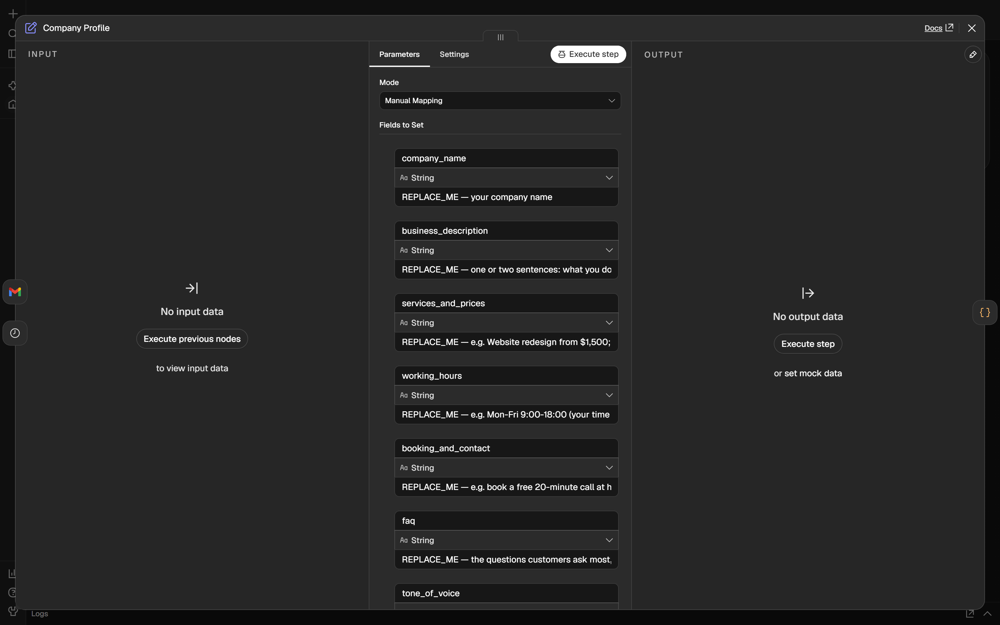
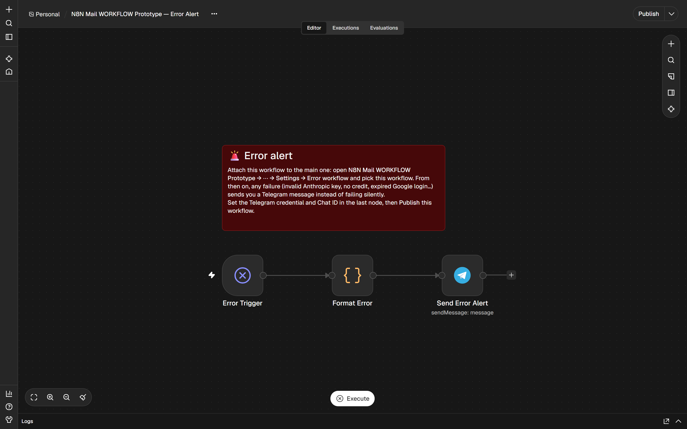

# N8N Mail WORKFLOW Prototype

**A free n8n workflow that reads your Gmail, sorts each email with Claude and prepares draft replies. It never sends an email by itself.**

[**Watch the interactive map**](https://ale-studios.github.io/n8n-mail-workflow-prototype/) · [Setup guide](SETUP.md) · [License](LICENSE.md)

> **Status: prototype.** It works in our tests, but it has not been used with real mail for weeks, and some parts have never been tested with the real services. Read the [status table](#status) before you rely on it. Always review a draft before you press Send.

*The whole workflow as it appears in n8n. The interactive map on the website shows a signal travelling through every one of these nodes.*

## What it does

1. Every minute it checks your Gmail inbox for new unread email (it skips promotions, social notifications and very large messages).
2. It adds your **Company Profile**: services, prices, opening hours, tone of voice and signature, which you write once.
3. **Claude** reads the email and answers with one word, its category.
4. The email goes down one of six roads:

| Category | What you get |
|---|---|
| Lead | A draft reply in Gmail, already addressed to the sender |
| Client question | A draft reply in Gmail |
| Invoice | A new row in your Google Sheet (amount, currency, due date) |
| Urgent | An alert on Telegram |
| Unsure | A yellow alert on Telegram, so nothing is silently ignored |
| Ignore | Nothing happens, the email stays in your inbox (newsletters and no-reply mail end up here) |

5. Every morning it looks at the emails **you** sent at least three days ago, checks the whole conversation, and drafts a polite reminder only if nobody has answered.
6. Every Monday it sends you a summary of the open invoices on Telegram.
7. A separate workflow (`error-alert.json`) sends you a Telegram message if any step breaks, for example because the API key is no longer valid.

**The rule that never changes: it only writes drafts.** A person has to read and press Send.

## Screenshots

These are screenshots of the real workflow, taken in n8n right after importing the files.

*The email flow: new email, Company Profile, Claude's classification, and the six roads (drafts, invoice row, Telegram alerts, or nothing).*

*The morning follow-up: it searches the emails you sent, reads each whole conversation, and drafts a reminder only when nobody answered.*

*The Company Profile node: the one form you fill in. Claude takes the facts about your business only from here.*

*The error workflow (`error-alert.json`): it sends you a Telegram message when any step fails.*

## What is in this repository

| File | What it is |
|---|---|
| `n8n-mail-workflow.json` | The main workflow (29 working nodes) |
| `error-alert.json` | A small second workflow that warns you when something fails |
| `SETUP.md` | Step-by-step setup guide |
| `media/` | The screenshots used in this README and on the website |
| `index.html` | The interactive map shown on the website |
| `LICENSE.md` | Free use license: free to use and change, not to sell |

## Quick start

1. Install and run [n8n](https://n8n.io) (self-hosted or cloud).
2. Create a Google Cloud project for Gmail access. This is a requirement of Google, takes 20 to 30 minutes, and is done once.
3. Create an Anthropic API key (pay as you go) and add it to n8n as a Header Auth credential.
4. Import both JSON files, fill in the **Company Profile** node, and choose your credentials in the nodes with a red triangle.
5. Run **Execute workflow** once with an unread email in your inbox, check the draft, then publish.

The full steps, with the traps we found, are in [SETUP.md](SETUP.md).

## Status

| | |
|---|---|
| **Tested with real Gmail (an earlier build)** | Reading emails, drafts with recipient and subject, reading a conversation for the follow-up |
| **Tested with simulated Gmail and a simulated Claude (current build)** | All six roads, requests with quotes and line breaks, the Company Profile, the error alert in active mode |
| **Not tested** | How well the real Claude classifies real and ambiguous emails, Google Sheets, Telegram delivery, running for days, n8n Cloud, a real follow-up on an email you sent |

Tested on n8n 2.40 to 2.43. Older versions may be missing some nodes.

## Limits you should know

- **n8n must stay on.** If it is off, emails wait.
- **Google access in test mode expires every 7 days.** Publish the Google app (see the guide) or reconnect weekly.
- **Attachments are not read.** An invoice that exists only as a PDF is logged with the status `needs_review`.
- **Claude can be wrong.** If its answer is unclear the workflow alerts you, but it cannot be perfect.
- **Drafts only see the incoming message**, not the whole conversation history.
- **Costs.** Each incoming email costs one or two Claude calls. There is no automatic spending cap: set a monthly limit in the Anthropic console.

## Privacy

The text of your emails is sent to Anthropic to be processed. Check that this fits your own privacy obligations and your clients' expectations before you use it.

## License and disclaimer

Free to use and to change, **not to sell**. See [LICENSE.md](LICENSE.md). It is provided as is, without warranty. This project is not affiliated with n8n, Google, Anthropic or Telegram.

## Feedback

Bug reports are welcome as GitHub Issues. This is a prototype shared for free: there is no support guarantee.
